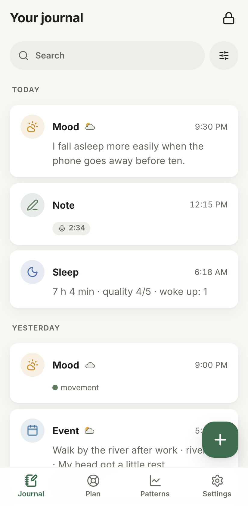
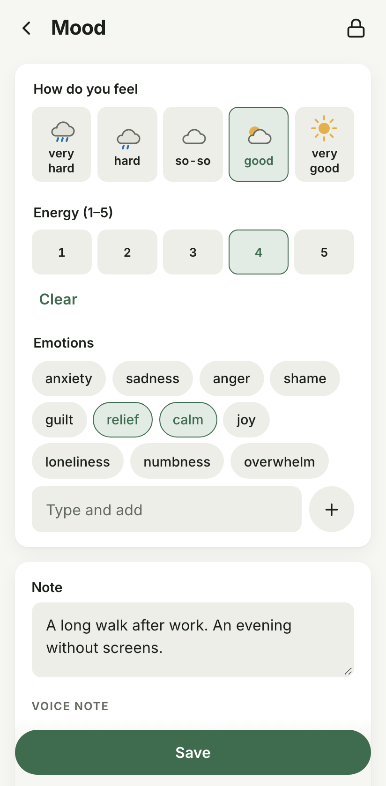
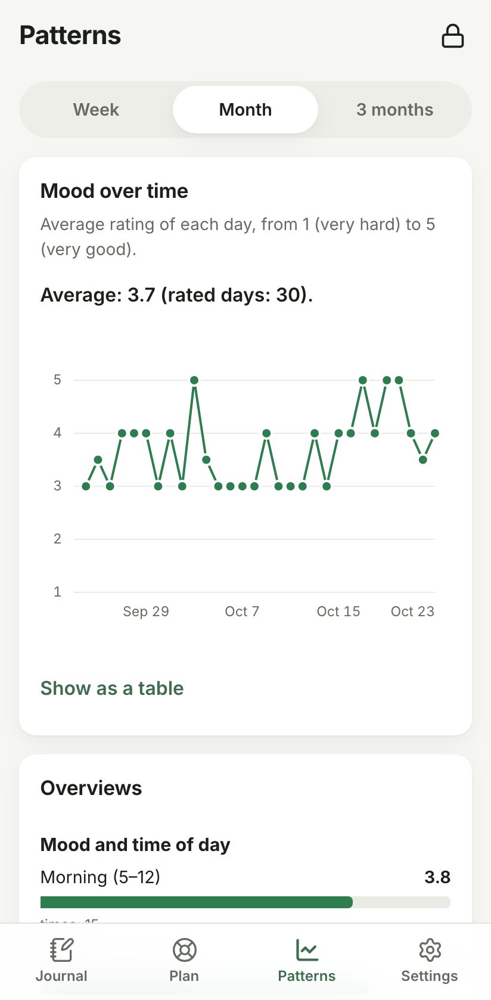

# Mossbook

[](https://github.com/jakub-m-arch/mossbook/actions/workflows/ci.yml)
[](LICENSE)

**A private, offline journal for mood, events, fears, sleep and nightmares.**

Mossbook is built for everyone, with particular care for people going through a hard
time and for people who see a therapist. Notes are written in seconds, kept
encrypted on your device, and can be shared with a therapist only if you choose to.

**Website and downloads:** <https://jakub-m-arch.github.io/mossbook/en/>
([po polsku](https://jakub-m-arch.github.io/mossbook/)). It walks through the app,
explains what Mossbook protects and what it does not, and links the right installer
for your system. The site has no cookies, analytics or third-party resources.

<p align="center">
  
  
  
</p>
<p align="center"><sub>Screenshots with made-up entries.</sub></p>

> **Your entries stay with you.** There is no server, no account and no
> telemetry. Everything is encrypted on your device, and the code is open so anyone
> can check.

> [!IMPORTANT]
> **Mossbook is not a medical device.** It does not diagnose, recommend treatment or
> assess your health, and it is not a substitute for professional help. It is a tool for
> writing down and organising your own observations. If you are in danger, call your local emergency number (112 in the EU).

---

## Status

**0.1 is out for desktop** (Linux, Windows, macOS). It is early software: keep a
backup (Settings → Backups and sync).

- **Done:** every desktop feature of the MVP, and from v1 the PDF report, nightmares,
  difficult content, the mood calendar, overviews, and quick entry while locked.
- **In progress:** Android. The app builds and runs on Android, with fingerprint
  unlock; there is no published APK yet.
- **Not yet:** iOS, reminders (they come with the mobile versions),
  and code-signed installers.

The specification is [`SPEC.md`](SPEC.md); the checklist and the decisions taken along
the way are in [`docs/PLAN.md`](docs/PLAN.md).

## Install

Download the installer for your system from
[Releases](https://github.com/jakub-m-arch/mossbook/releases) and check it against
`SHA256SUMS` (see [`SECURITY.md`](SECURITY.md#verifying-a-release)).

- **Linux:** `.AppImage` (make it executable) or `.deb`.
- **Windows:** `.msi` or `-setup.exe`. SmartScreen may warn because the installer is
  not code-signed yet: *More info → Run anyway*.
- **macOS:** the easiest way is Homebrew, which opens the app without warnings and
  updates it with `brew upgrade`:

  ```sh
  brew install --cask jakub-m-arch/mossbook/mossbook
  ```

  Or the `.dmg` (Apple Silicon `aarch64`, Intel `x64`). The app is not notarized yet,
  so macOS blocks the first launch: open it once, then choose *Open Anyway* in
  *System Settings → Privacy & Security*.

### Updates

Mossbook never connects to the internet, so it does not check for updates by itself.

- **Settings → About → Check for updates** opens the releases page in your browser.
  After three months, Settings also notes that the version is getting old (worked out
  from the build date, offline).
- **Get notified:** on [the repository](https://github.com/jakub-m-arch/mossbook),
  *Watch → Custom → Releases*, and GitHub emails you when a new version is out.
- With Homebrew, `brew upgrade` is enough. Otherwise install the new version over
  the old one. Your journal stays where it
  is; keeping a recent backup (Settings → Backup) is still a good idea.

## What it does

- **Entry types**: mood (1–5 with emotions), event, fear or trigger (intensity before
  and after a coping strategy), sleep, nightmare with a rewritten version, free note.
- **Quick entry** in at most two taps, to be completed later.
- **Timeline** with filters by type, tag and date, and full-text search that ignores
  case and diacritics (searching `lodz` finds `Łódź`).
- **Plan for a hard moment** you write yourself, with crisis
  phone numbers and grounding exercises available **without unlocking**.
- **Patterns**: mood over time, a mood calendar and overviews (tags, triggers, sleep,
  time of day, strategies), shown as plain observations, never clinical conclusions.
- **Encrypted backup** to a single `.mossbook` file; restore on a new device or merge.
  **Automatic backups** on this device every day, and a way to check that your
  written-down recovery key works.
- **Voice notes** of up to five minutes, recorded in the app and encrypted like the
  rest.
- **Voice notes to text**, off by default: after you download a speech recognition
  model in your browser and point Mossbook to the file, a recording can be turned into
  text on the device, for you to read and correct (see below).
- **The same journal on your phone and your computer** through a folder that
  [Syncthing](https://syncthing.net) shares between them (see below); Mossbook itself
  still never connects anywhere.
- **Your data stays portable**: export everything as a readable ZIP (JSON and your
  voice notes) at any time.
- **Report for your therapist** as a PDF for a chosen period, types and tags,
  optionally protected with a password (AES-256).
- **Quick entry from the lock screen** without the password: it can add, never read.
- **Languages**: Polish, English and Ukrainian from the first release.
- **Calm by design**: no streaks, points, badges or guilt-inducing notifications.

## Using Mossbook on more than one device

Mossbook never connects to the network, so it does not sync by itself. It writes one
encrypted file per device into a folder of your choice, and
[Syncthing](https://syncthing.net) (free, open source, device to device, no cloud)
carries that folder between your phone and your computer.

1. Install Syncthing on both devices and share one folder between them, for example
   `MossbookSync`.
2. On the device whose journal you want to keep (its password and 24-word recovery key
   stay), open Settings → Backups and sync → *Choose folder* and pick that folder.
3. Wait until Syncthing has copied its file to the other device. There, choose the same
   folder in Settings → Backups and sync. Mossbook finds the other journal and offers to join it:
   type **that** journal's password. The entries of this device are added to it, and
   from then on both devices have the same journal, password and recovery key. The
   journal this device had before is kept in its automatic backups.

Each device writes its file when the journal locks and reads the others' changes when
it unlocks or comes back to the screen. If you change the same entry on both devices,
the newer change stays; deletions travel too. The file is encrypted like a backup;
whoever can see the folder learns how many devices there are, how big each file is and
when it changed, nothing more. The details are in
[`docs/backup-format.md`](docs/backup-format.md) (*Sync files*).

## Turning voice notes into text

Optional and off by default. Recognition runs on your device with NVIDIA's Parakeet
model (Polish, Ukrainian, English and other European languages); recordings are never
sent anywhere.

1. Settings → Voice notes → *Open the download page*. Your browser
   downloads the model (`sherpa-onnx-nemo-parakeet-tdt-0.6b-v3-int8.tar.bz2`, 487 MB).
   Mossbook itself downloads nothing.
2. *Pick the downloaded file*. Mossbook accepts only that exact file (checked by its
   SHA-256) and unpacks what it needs (about 670 MB). You can then delete the download.
3. In an entry with a voice note, *Turn into text*. Read the text and correct it before
   saving; it is stored with the entry, encrypted, and found by search.

Transcription needs about 1.5 GB of memory while it runs, so on a phone with less than
6 GB it may fail. The model belongs to this device: it is not in backups or sync, and
removing it in Settings turns the feature off. Five minutes of speech take about 20
seconds on a recent computer and longer on a phone.

**What this means for "zero network".** The app still makes no connections and has no
networking code. The recognition engine, however, comes as libraries prebuilt by the
[sherpa-onnx](https://github.com/k2-fsa/sherpa-onnx) project (with ONNX Runtime), not
built from source by Mossbook. Their build script can download those libraries, so it
brings a networking crate (`ureq`) into the *build* tools: `deny.toml` allows it there
and nowhere else, and Mossbook's builds hand the script archives checked against
SHA-256 sums pinned in [`tools/sherpa-onnx.sha256`](tools/sherpa-onnx.sha256), so it
never connects. The details and the trade-offs are in decision D-23 in
[`docs/PLAN.md`](docs/PLAN.md), [`SECURITY.md`](SECURITY.md) and the
[threat model](docs/threat-model.md).

## Privacy and security

| Principle | How |
|---|---|
| Zero network | No networking code in the app (enforced by `cargo deny`; the one build-time exception is described under *Turning voice notes into text*). The Android release build does not even hold the `INTERNET` permission, and none of its native libraries imports socket functions (checked in CI). |
| Everything encrypted at rest | Every record, tag, date and setting is encrypted with XChaCha20-Poly1305. Nothing readable is stored on disk. |
| Strong password hashing | The key is derived from your password with Argon2id (64 MiB, calibrated to ~0.75 s on your device). |
| Recovery key | 24 words (BIP-39) generated when you create the journal. Without your password **and** this key, nobody can recover your entries, including us. |
| Tamper detection | Each record is authenticated and bound to its id, type and vault, so swapped or altered records are detected. |
| Auto-lock | Immediately when the app goes to the background (default), or after 1, 5 or 15 minutes. The decision is made in Rust, not in the web view. |
| No leaks to logs | Logging is forbidden by lints; types holding your text have redacted `Debug` output and are wiped from memory when the journal locks. |
| No telemetry | None, not even "anonymous" analytics or crash reports. |

Out of scope: a device with malware or root access, keyloggers, physical coercion, and
memory analysis while the journal is unlocked.

The cryptographic design is documented in [`docs/crypto.md`](docs/crypto.md) and the
backup file in [`docs/backup-format.md`](docs/backup-format.md), in enough detail to
write an independent reader. The test vectors are cross-checked against libsodium and
argon2-cffi by [`tools/verify-vectors.py`](tools/verify-vectors.py),
[`tools/read-backup.py`](tools/read-backup.py) opens backups without any Mossbook code,
and [`tools/read-report.py`](tools/read-report.py) opens a password-protected report PDF.

What Mossbook does and does not protect against, including known limitations, is in
[`docs/threat-model.md`](docs/threat-model.md).

**Found a security issue?** Please do not open a public issue; see
[`SECURITY.md`](SECURITY.md).

## Architecture

```
┌──────────────────────────────┐
│  Svelte 5 + TypeScript (UI)  │  presentation only, never sees a key
└──────────────┬───────────────┘
               │ typed Tauri commands (app/src/lib/api)
┌──────────────▼───────────────┐
│  app/src-tauri               │  thin layer: commands, session state, auto-lock
└──────────────┬───────────────┘
┌──────────────▼───────────────┐
│  core (mossbook-core)        │  pure Rust, no Tauri: crypto, vault, domain, queries
└──────────────┬───────────────┘
               │ encrypted blobs only
          vault.db (SQLite)
```

- **[Tauri 2](https://tauri.app)** for desktop (Linux, Windows, macOS), later Android and iOS.
- **Rust** for everything that touches data. Cryptography uses audited
  [RustCrypto](https://github.com/RustCrypto) crates; no home-grown primitives.
- **Svelte 5 + SvelteKit** (static SPA) for the interface. All assets are local; no CDN.

How the pieces fit together, module by module, is in
[`docs/architecture.md`](docs/architecture.md).

```
mossbook/
├── core/             mossbook-core: crypto/, store/, vault/, domain/, journal.rs,
│   │                 query/, backup/, report/, crisis.rs
│   ├── data/         crisis phone numbers per country (with sources), report fonts
│   ├── migrations/   SQL schema
│   └── tests/        integration tests and the format-v1 fixtures
├── app/
│   ├── src-tauri/    Tauri commands, session, capabilities; gen/android (Android project)
│   ├── src/          Svelte UI (routes/, lib/api, lib/i18n, lib/components)
│   └── e2e/          Playwright scenarios against a fake backend
├── docs/             architecture.md, crypto.md, backup-format.md, threat-model.md,
│                     release.md, PLAN.md
├── packaging/        Homebrew cask template
├── site/             the website (static HTML, CSS, local fonts, screenshots)
├── tools/            independent readers (verify-vectors.py, read-backup.py, read-report.py),
│                     check-android-apk.sh
└── SPEC.md           specification
```

## Building from source

### Prerequisites

- **Rust**: installed with [rustup](https://rustup.rs). The exact toolchain is pinned in
  [`rust-toolchain.toml`](rust-toolchain.toml) and installed automatically.
- **Node.js** 24 or newer, with npm.
- **CMake**, which builds libopus (used to decode voice notes for transcription).
- **The sherpa-onnx libraries** for transcription, fetched once and checked against
  pinned SHA-256 sums: `tools/fetch-sherpa-onnx.sh` (add `android` for Android
  builds). The build takes them from `target/sherpa-onnx-archives` and stops if they
  are missing, rather than downloading anything itself.
- **Tauri CLI**: `cargo install tauri-cli --locked`
- **Platform libraries** for Tauri, see the
  [Tauri prerequisites](https://tauri.app/start/prerequisites/). On Debian/Ubuntu:

  ```sh
  sudo apt-get install libwebkit2gtk-4.1-dev libxdo-dev libayatana-appindicator3-dev librsvg2-dev
  ```

### Run

```sh
git clone https://github.com/jakub-m-arch/mossbook.git
cd mossbook/app
npm ci
cargo tauri dev          # development build with hot reload
cargo tauri build        # release build and installers
```

The journal is stored as `vault.db` in the platform's application data directory,
for example `~/Library/Application Support/io.github.jakubmarch.mossbook/` on macOS
or `~/.local/share/io.github.jakubmarch.mossbook/` on Linux.

### Android

You need JDK 17, the Android SDK command-line tools (platform-tools, a platform,
build-tools) and an NDK, with `JAVA_HOME`, `ANDROID_HOME` and `NDK_HOME` set, and
`ANDROID_NDK_ROOT` pointing to the same NDK for CMake (see
the [Tauri Android prerequisites](https://tauri.app/start/prerequisites/#android)),
and the Rust targets:

```sh
rustup target add aarch64-linux-android armv7-linux-androideabi x86_64-linux-android i686-linux-android
cd app
cargo tauri android dev                   # on a connected phone (USB debugging) or an emulator
cargo tauri android build --apk           # release APK (unsigned)
../tools/check-android-apk.sh src-tauri/gen/android/app/build/outputs/apk/universal/release/app-universal-release-unsigned.apk
```

The Android project lives in `app/src-tauri/gen/android` and is committed: its
manifest, `MainActivity.kt` and resources carry the hardening from SPEC §8.4. Do not
regenerate it with `cargo tauri android init` without carrying those changes over (a
test in `app/src-tauri` checks them).

## Development

Run these before sending a change (CI runs the same):

```sh
# Rust (from the repository root)
cargo fmt --all
cargo clippy --workspace --all-targets -- -D warnings
cargo test --workspace
cargo deny check         # licenses, advisories, banned networking crates
cargo audit

# Frontend (from app/)
npm run lint
npm run check
npm test
npx playwright install chromium   # once
npm run test:e2e
```

### Tests

- **Core**: round-trips, wrong passwords and recovery keys, every flipped byte, swapped
  records, tampered headers, property tests over arbitrary entries, and a committed
  vault file from format version 1 that every future build must still open.
- **App**: session state machine, auto-lock policy, and checks that the command list,
  the capability file and the TypeScript wrappers stay in sync.
- **UI**: unit tests (Vitest) and end-to-end scenarios (Playwright) against an
  in-browser stand-in for the Tauri backend.

All test data is synthetic.

### Website

The website lives in [`site/`](site/README.md) and is plain HTML and CSS with no build
step. [`.github/workflows/pages.yml`](.github/workflows/pages.yml) publishes it to
GitHub Pages whenever `site/` changes on `main` and whenever a release is published,
so the download links always point at the newest version. Preview it locally:

```sh
site/render.sh 0.1.2 /tmp/mossbook-site && python3 -m http.server -d /tmp/mossbook-site
```

The screenshots are taken from the app with made-up entries; regenerate them after UI
changes with `npx playwright test -c playwright.site.config.ts` (from `app/`).

## Contributing

Contributions are welcome, especially translations and reviews of the security design.
Please read [`CONTRIBUTING.md`](CONTRIBUTING.md).

- Read the rules in [`CLAUDE.md`](CLAUDE.md); they apply to human contributors too:
  no network code, no plaintext on disk, no logging of user data, no home-grown crypto,
  no telemetry, and calm, non-clinical wording in the UI.
- Changes to `core/crypto`, `core/vault` or the file formats need tests, including
  negative ones. A format change means a version bump, a migration and a migration test.
- Sign off your commits (`git commit -s`) to certify the
  [Developer Certificate of Origin](https://developercertificate.org).
- Texts and their wording matter here. Interface copy speaks to the user in the second
  person, plainly and warmly, without diagnoses or judgement.

## License

Mossbook is free software under the [GNU General Public License v3.0 or later](LICENSE),
with an [additional permission](LICENSE-EXCEPTION.md) (GPLv3 section 7) that allows
distribution through app stores as long as the source code stays available to everyone.

Copyleft is deliberate: an app whose value is trust should not be forked into a closed
version with tracking added.
